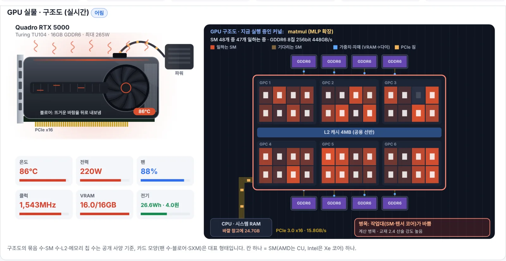
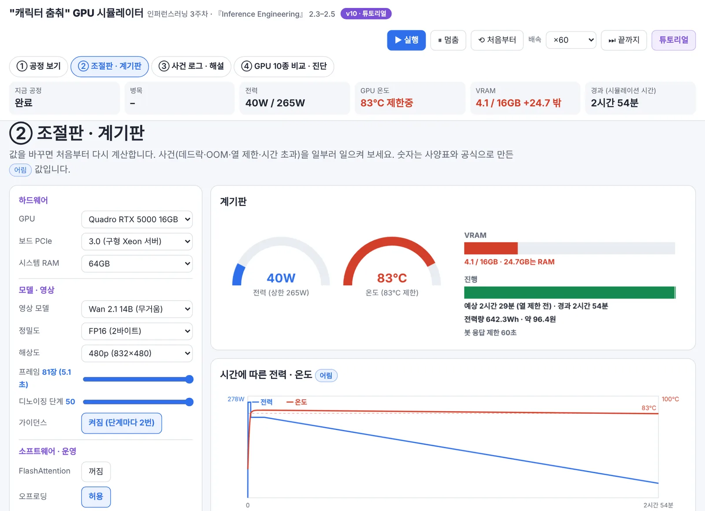
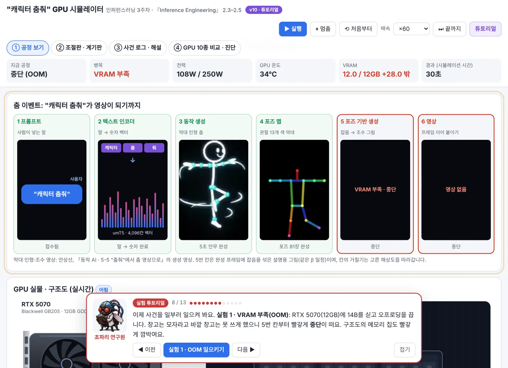

# 병목을 찾아라 — 인퍼런스러닝 3주차

**『Inference Engineering』 2장 2.3–2.5 인터랙티브 해설**

> GPU가 느릴 때 필요한 것은 더 빠른 요리사일까, 더 넓은 재료 통로일까?

▶ **바로 보기:** https://adminmrobo.github.io/inference_engineering_study_week_02_textbook_ch02_p3_to_end/
▶ **같은 범위의 발표 슬라이드:** https://adminmrobo.github.io/inference_engineering_study_week_02_textbook_ch02_p3_to_end_slide/

글 · 안상선 ((주)M-Robo 대표)
원전 · Philip Kiely, 『Inference Engineering』 (Baseten Books, 2026) 2장

---

## 이번 주 자료 모음

| 자료 | 무엇 | 열기 |
|---|---|---|
| 읽기용 해설 | 아홉 걸음 인터랙티브 해설 (블로그) | https://adminmrobo.github.io/inference_engineering_study_week_02_textbook_ch02_p3_to_end/ |
| 본 발표 슬라이드 | 본편 46장 + 부록 17장, 공장 비유·GPU 10종 대시보드 | https://adminmrobo.github.io/inference_engineering_study_week_02_textbook_ch02_p3_to_end_slide/ |
| 쉬운 가이드 | 도입 12장 + 핵심만 쉽게 17장(흰 배경, 초보자용) | https://adminmrobo.github.io/inference_engineering_study_week_02_textbook_ch02_p3_to_end_slide/easy_guide.html |
| "캐릭터 춤춰" GPU 시뮬레이터 | 춤 영상이 만들어지는 동안 GPU의 열·전력·시간·데드락·병목을 직접 일으켜 보는 4쪽 시뮬레이터, 연구실 캐릭터 튜토리얼 13단계 | https://adminmrobo.github.io/inference_engineering_study_week_02_textbook_ch02_p3_to_end_slide/gpu_dance_simulator.html |

## "캐릭터 춤춰" GPU 시뮬레이터 미리보기

생성형 AI에 "캐릭터 춤춰"라고 했을 때 GPU 안에서 무슨 일이 일어나는지 값을 직접 바꾸며 보는 실험실입니다. ▶ https://adminmrobo.github.io/inference_engineering_study_week_02_textbook_ch02_p3_to_end_slide/gpu_dance_simulator.html

**① 춤 이벤트 6칸.** 프롬프트 → 텍스트 인코더 → 동작 생성(막대 인형) → 포즈 맵(관절 13개) → 포즈 기반 생성(잡음이 걷힘) → 영상. 고른 GPU의 속도대로 칸이 하나씩 켜집니다.

**② GPU 실물 · 구조도.** Quadro RTX 5000이 14B 모델을 돌리는 중. SM 48칸이 열 색으로 깜박이고, VRAM이 모자라 24.7GB를 시스템 RAM에서 PCIe로 실어 옵니다. 실행 중인 커널, 병목 꼬리표, 온도·팬·전력이 함께 보입니다.

**③ 조절판 · 계기판.** GPU 10종, 모델, 정밀도, 해상도, 단계, FlashAttention, 오프로딩, 동시 요청, 냉각을 바꾸면 전력·온도·VRAM·시간이 다시 계산됩니다.

**④ 연구실 튜토리얼.** 박사·조수·초파리 연구원·주판봇이 13단계로 안내합니다. "실험 1"을 누르면 RTX 5070에서 VRAM 부족(OOM)이 일어나 5번 칸부터 멈춥니다.

해 볼 수 있는 사건: VRAM 부족(OOM) · 데드락 · 열 제한(83°C, 클럭 −15%) · 봇 응답 시간 초과 · 처방(FlashAttention·FP8·적은 단계) · GPU 10종 비교 · 도전 모드("어쭈!" 360p → 4K)

## 이 페이지는

AI가 느릴 때 무엇을 고쳐야 하는지 아홉 단계로 나누어 설명합니다. GPU를 식당 주방에 비유해 계산 성능(요리사의 손)과 메모리 대역폭(재료 통로)이라는 두 자원을 먼저 익힙니다. 이어서 그림·영상 생성 AI가 일하는 방식을 보고, 어디가 막혔는지 재는 루프라인 그래프를 배웁니다. 마지막으로 가장 비싼 계산인 어텐션을 줄이는 방법을 정리합니다. 수식을 몰라도 슬라이더만 움직이면 따라올 수 있습니다.

진행은 연구실 네 캐릭터가 맡습니다. **박사**가 해설과 판정, **조수(하루)**가 실험과 숫자, **초파리 연구원**이 의심하는 쪽, **주판봇**이 큰 숫자에 거는 쪽입니다.

## 아홉 걸음

| # | 걸음 | 교재 | 핵심 한 줄 |
|---|---|---|---|
| ① | GPU 주방 둘러보기 | 2.4.1 | 계산 성능(FLOPS)과 메모리 대역폭, 두 자원이 있다 |
| ② | 잡음에서 그림으로 | 2.3, 그림 2.10 | 이미지는 잡음을 30–50번 고쳐 써서 만든다 |
| ③ | 잠재 공간과 두 번 계산 | 2.3 | 작게(128×128) 그리고, 단계마다 순전파 두 번. 디노이저 학습을 아주 쉽게: 정답을 아는 퀴즈, 칸 4개 손실 계산, 고르기(−log) vs 맞히기(차이²), 경사 하강 |
| ④ | 단계를 줄이면 | 2.3.2 | 퓨스텝 모델: 8단계 이하, 80–90% 빨라짐 |
| ⑤ | 영상은 시간까지 | 2.3.3 | 영상은 파라미터 3–5배, 잠재 정보 10–100배 |
| ⑥ | 어디가 막혔나 | 2.4.1, 그림 2.12–2.13 | 루프라인: 산술 강도 < ops:byte(H100 ≈ 295)면 메모리 병목 |
| ⑦ | 어텐션 계산표 | 2.4.2, 그림 2.14–2.18 | 책 예제(N=4096, d=128)의 산술 강도는 62 |
| ⑧ | 동선 줄이기 | 2.5 | FlashAttention(한 번에 처리), PagedAttention(KV 캐시를 칸 단위로) |
| ⑨ | 레시피 바꾸기 | 2.5 | 슬라이딩 윈도우(창 8K–32K), 선형 어텐션, 맘바 |

마지막에는 대결(연산 ×2 vs 대역폭 ×2), 정리, 지식 색인(#kg), 온톨로지·서지 꾸러미(#export)가 이어집니다.

## 쓰는 법

- **노란 점선 밑줄** 위에 마우스를 올리거나 누르면 뜻풀이가 나옵니다. 오른쪽 아래 도우미에서 밑줄 범위를 핵심 → 전체 → 끄기로 바꿀 수 있습니다.
- 걸음마다 맨 위 초록 상자에 **"이것만 기억하세요"** 한 줄이 있습니다.
- 퀴즈가 18개 있고, 오른쪽 아래에 읽은 곳과 퀴즈 진행이 표시됩니다.
- 파일 하나(`index.html`)로 동작하며 외부 스크립트를 쓰지 않습니다. 글꼴만 Google Fonts에서 받고, 오프라인이면 기본 글꼴로 열립니다.

## 파일 구성

| 파일 | 설명 |
|---|---|
| `index.html` | 해설 페이지 본체 (단일 파일) |
| `IMG_03_bottlenecks.md` | 이미지 제작 명세서: 필요한 그림 전체, 프롬프트, 넣는 법 |
| `COVER_03_bottlenecks.md` | 표지(cover_03) 한 장을 Genspark에 맡기는 지시문 |
| `KG_03_registry_additions.json` | 지식 색인에서 시리즈 레지스트리에 더할 항목 |
| `images/` | 받은 그림을 넣는 폴더 (`images/README.md` 참고) |

## 그림 넣기

`images/`에 그림 여섯 장(표지 `cover_03`, 제목 배경 `bg_03`, ⑥ 칸 컷 `cut_03_lv6`, 아웃트로 `sc_03_outro`, 공유 미리보기 `og_03`, 썸네일 `thumb_03`)이 들어 있고 페이지가 자동으로 불러옵니다. 그림 파일이 없으면 CSS 대체 표지와 캐릭터 그림으로 그대로 동작합니다. 그림을 바꿀 때는 같은 이름으로 덮어쓰면 됩니다. 사양은 `IMG_03_bottlenecks.md`를 보세요.

## 출처와 표기

- 원전: Philip Kiely, *Inference Engineering*, Baseten Books, 2026, 2장 2.3–2.5. 책의 그림 번호(2.10–2.18)는 그대로 쓰고 그림은 새로 그렸습니다.
- 책에서 온 숫자에는 각주 번호를 달았습니다. 번호가 없는 숫자는 설명을 위해 정한 값입니다.
- 캐릭터(박사·조수(하루)·초파리 연구원·주판봇) 기준 그림: [adminmrobo/fruitfly-lab-expressions](https://github.com/adminmrobo/fruitfly-lab-expressions)
- 각 주차 해설은 따로 읽을 수 있는 독립된 편입니다.

© 안상선 ((주)M-Robo)
